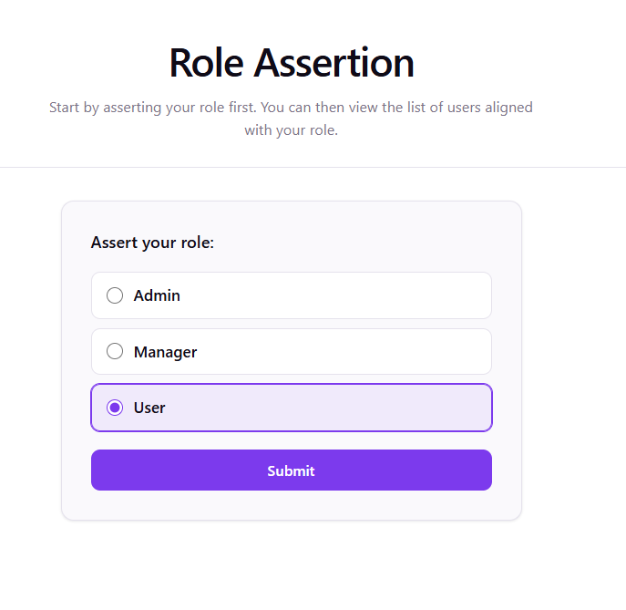
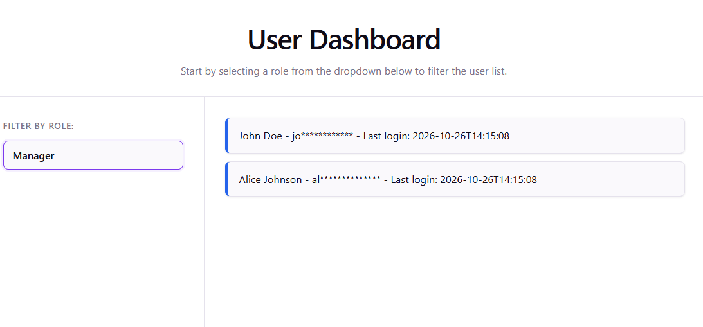
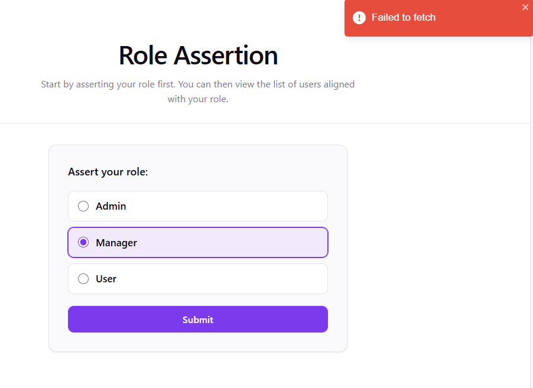

# User Information Dashboard Project V2
This V2 is built using AI-assisted coding with Gemini CLI based on V1. The prompt asked to add a stage before the dashboard. This new stage will assert a role to the backend service and receive a JWT token containing the asserted role. The user list will be queried with this JWT. 

The Gemini agent was also asked to improve the UI style and testing thereafter.

## Reference
- [V1](https://github.com/yingqiaogit/user-dashboard/tree/v1)

## Backend Service
Users will be streamed out with 1 second in between.
- [User Provider](https://github.com/yingqiaogit/user-provider)

## Configuration 
- `npm install`
- Add a `.env.development` file in the project folder with the line:
  `VITE_BACKEND_SERVER=http://localhost:8080`

## Run 
- `npm run dev`

### UI
#### Role Assertion
There are three roles that can be selected: `Admin`, `Manager`, `User`

#### With Users
A list of users will be displayed after a role filter is selected:

#### Error
An alert will appear when an error occurs:

