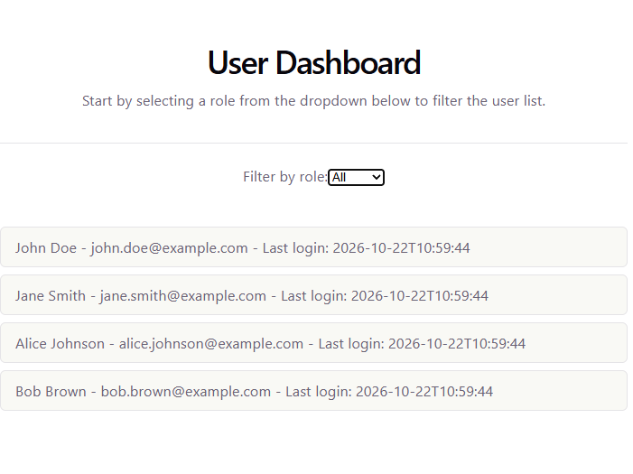
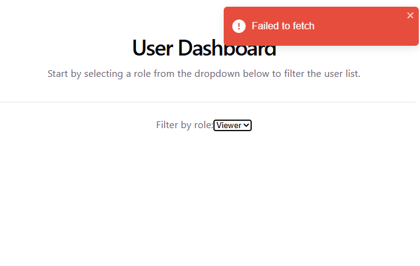

# User Information Dashboard Project V2
This is a practice of React UI. This dashboard UI pulls data from a backend service. 
This dashboard allows user to specify a role of users to view their information in a list.

## Backend Service
Users will be streamed out with 1 second in between.
- [User Provider](https://github.com/yingqiaogit/user-provider)

## Configuration 
- `npm install`
- add `.env.development` file in project fold with line:
  `VITE_BACKEND_SERVER=http://localhost:8080`

## Run 
- `npm run dev`

### UI
#### With Users
A list of users will be displayed after a role is selected:

#### Error
An alert will raise when an error occurs:
