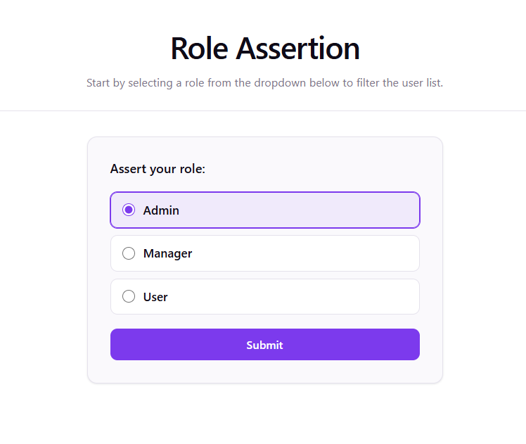

# User Information Dashboard Project V2
This V2 is built from AI-assistant coding with Gemini. The prompt was asked to add a stage before dashboard. This new stage will assert a role to backend service and receive a JWT token containing the asserted role. The user list will be queried with this JWT. 

The Gemini agent also were also asked to improve the UI style and testing.

## Backend Service
Users will be streamed out with 1 second in between.
- [User Provider](https://github.com/yingqiaogit/user-provider)

## Configuration 
- `npm install`
- add `.env.development` file in project fold with line:
  `VITE_BACKEND_SERVER=http://localhost:8080`

## Run 
- `npm run dev`

### UI
#### Role Assertion
There are three roles can be selected: `Admin`, `Manager`, `User`

#### With Users
A list of users will be displayed after role filter is selected:

#### Error
An alert will raise when an error occurs:
